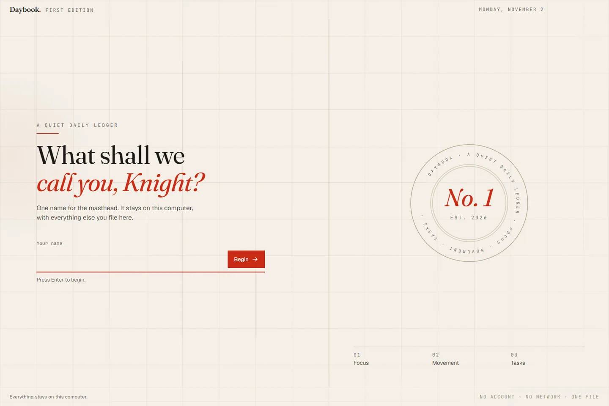
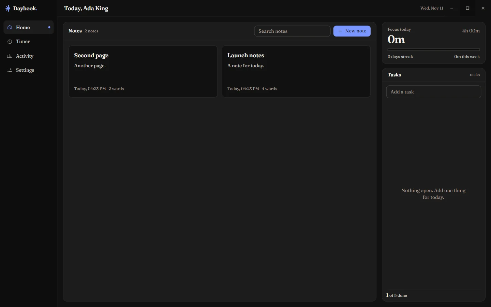
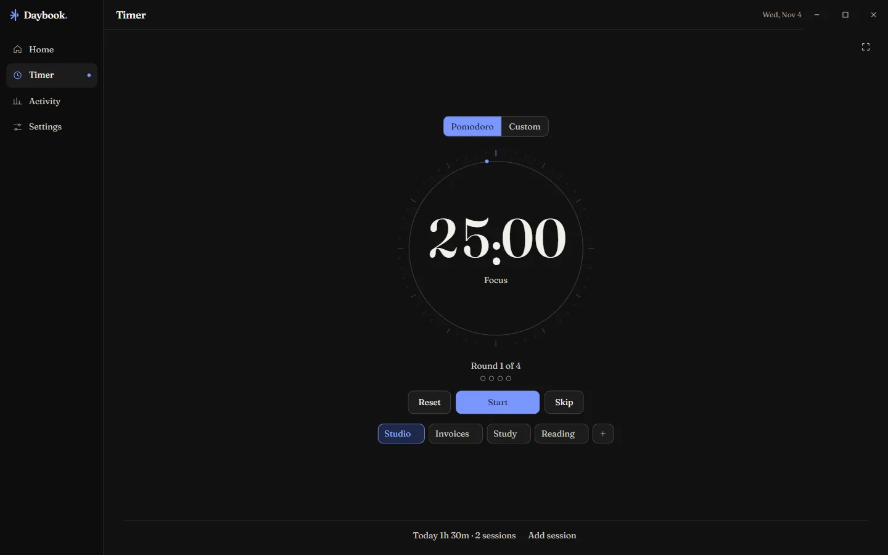
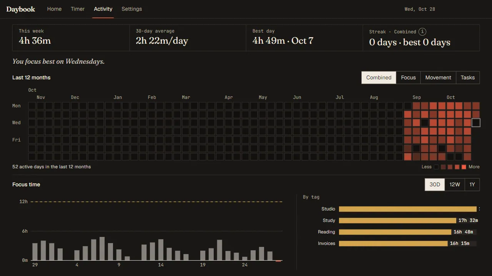
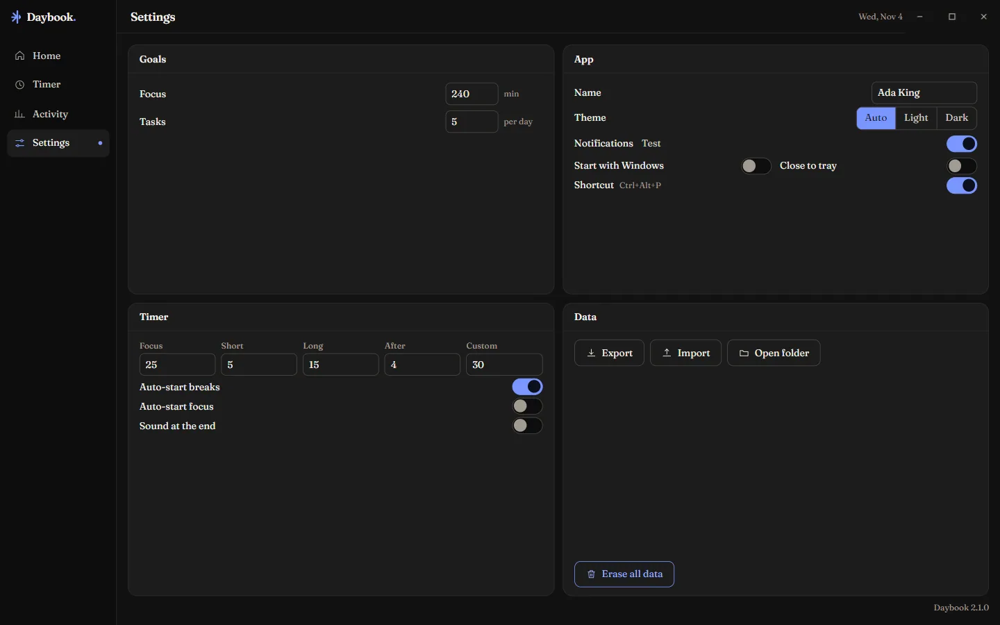

# Daybook

**A small, calm desktop tracker for the work you meant to do.** Four tabs — Home,
Timer, Activity, Settings — and every one of them fits on a single screen with no
scrolling. One window, one JSON file, no account, no network code at all.

**Latest release:** [v1.3.0](../../releases/latest) · Windows 10/11 x64 · [MIT licence](LICENSE)



Daybook keeps the printed-page identity of the earlier releases — warm paper, the
Fraunces / Geist / JetBrains Mono trio (bundled, so it renders offline), one
vermilion accent — and nothing else. No sidebar, no command palette, no status
bar, no vanity numbers.

## Contents

- [Download](#download)
- [What it does](#what-it-does)
- [Screens](#screens)
- [Where your data lives](#where-your-data-lives)
- [Build from source](#build-from-source)
- [Release assets](#release-assets)
- [Keyboard](#keyboard)
- [Architecture](#architecture)
- [Testing](#testing)
- [Packaging and the SmartScreen warning](#packaging-and-the-smartscreen-warning)
- [Changelog](#changelog)
- [Licence](#licence)

## Download

Grab the newest build from [**Releases**](../../releases/latest). Both files are
the same app; pick the one that suits you:

| File | What it is |
|---|---|
| `Daybook-Setup-1.3.0.exe` | Installer. Per-user, no admin rights, choose the folder, desktop + Start Menu shortcuts, clean uninstaller that leaves your data alone. |
| `Daybook-Portable-1.3.0.exe` | Single file, nothing installed. Runs from a USB stick or a Downloads folder; its data still lives in `%APPDATA%\Daybook`. |

**Requirements:** Windows 10 1809 or newer, or Windows 11, x64. 1000 × 600 is
the smallest window Daybook will draw itself in.

The builds are not code-signed, so the first launch shows Windows SmartScreen —
click **More info → Run anyway**. See [that section](#packaging-and-the-smartscreen-warning)
for how to remove the warning properly.

## What it does

Daybook answers four questions and then gets out of the way.

| Tab | The one thing you do there |
|---|---|
| **Home** | See today at a glance — focus time, movement, a rolling to-do list — and start either of the first two with a single button. |
| **Timer** | Run a Pomodoro or a custom-length focus session. It keeps counting while minimised, in the tray, or after a restart, and logs itself when it ends. |
| **Activity** | Look back: a five-level calendar heatmap, a focus chart over 30 days / 12 weeks / 1 year, and a by-tag breakdown. Click any day to correct it. |
| **Settings** | Adjust goals, timer lengths, tags and name. Everything saves as you type. |

A new install is greeted **once**, by name:

> *What shall we call you, Knight?*

Type it, press Enter, and you are in. The name then appears in exactly two
places — the Home heading (`Today, Ada`) and an editable **Name** row in
Settings → App — and the screen never returns.

The rules the interface is built on:

1. **One screen, no scroll.** No tab, panel, sidebar or window shows a scrollbar,
   from 1000 × 600 to 1920 × 1080 at 100 / 125 / 150 % scaling.
2. **One primary action per screen.**
3. **Never the same number twice on one screen.**
4. **Plain words** on every label.
5. **Delete, don't hide** — removed features take their code with them, while
   stored data stays intact and readable.

## Screens

| Home | Timer |
|---|---|
|  |  |

| Activity | Settings |
|---|---|
|  |  |

## Where your data lives

```
%APPDATA%\Daybook\
  daybook.json                            the live document (atomic writes)
  backups\daybook.1.json … 5.json         the last five distinct saves
  backups\pre-<version>-<timestamp>.json  a copy taken before a schema migration
  window.json                             window size, position and maximised state
```

Writes are atomic — serialise → temp file → `fsync` → rename over the target — so
a crash mid-write can never leave a half-written file. Every save rotates a
backup, and a corrupt live file is recovered from the newest readable one at
startup. **Export** and **Import** (Settings → Data) use native Windows dialogs.

### The document (schema v3)

```jsonc
{
  "version": 3,
  "createdAt": "…",                  // first launch, for the record
  "settings": { "goals": {…}, "pomodoro": {…}, "tags": [ … ], "theme": "system", … },
  "days": { "2026-10-08": { "sessions": [ … ], "movements": [ … ], "tasks": [ … ], "note": "" } },
  "timer": { "mode": "focus", "endsAt": 1759…, "customMinutes": 30, … },
  "meta": { "launches": 12, "seeded": true, "tasksStartAt": "2026-10-08" },

  // Written by the Welcome screen. Absent until a name has been given — which is
  // exactly the condition that shows it: a document with no `profile.name` has
  // never been greeted.
  "profile": { "name": "Ada Lovelace", "createdAt": "…" },
  "onboarding": { "completed": true, "version": 1 }
}
```

- **Sessions** are focus time: `{ tag, startedAt, minutes, auto }`.
- **Movements** are `{ type, minutes, intensity, at }`.
- **Tasks** live inside the day they were written in, which is what keeps the
  history honest: a task finished today counts today (`doneAt`) even if it was
  written a fortnight ago.
- **`meta.tasksStartAt`** is the day the single rolling to-do list began. Open
  tasks written before it belong to the retired per-day editions; they stay in
  the file byte for byte, and are simply not listed.

Migrations are idempotent and each is preceded by a raw copy of the file in
`backups\pre-<version>-<timestamp>.json`, so an upgrade can always be wound back
by hand. Nothing is ever deleted by a migration — sessions, movement, tasks,
goals and old daily notes all survive.

`profile` and `onboarding` arrived in v3 and are purely additive: the v2 → v3
migration writes nothing at all, because a document without a name is the one
that should be greeted. That is also what greets an owner upgrading from
v1.0.0 — once. **Erase all data** keeps the name (who you are is not part of
what you tracked), so the Welcome screen cannot come back after it. A
hand-edited name the interface would refuse (digits, punctuation, over 24
characters) is treated as no name rather than printed back.

### The rolling task list

Home shows **one** list, not one per day. Completing a task removes it and counts
toward "N of 5 done today", with an *Undo* toast for five seconds. At most seven
(`MAX_OPEN_TASKS`) are open at once — at the cap the input is disabled with
"List is full — finish or delete one." — which is what makes the no-scroll rule
possible.

### Streak rules

A day counts toward a run when the goal being measured was met; the filter above
the heatmap picks Combined, Focus, Movement or Tasks. One missed day per week
keeps the run alive without adding to it. Today never breaks a run — the day is
still in progress — so an unmet today simply does not add to the count yet.

## Build from source

```powershell
npm install          # also downloads the Electron runtime (~110 MB), offline thereafter
npm run dev          # Vite dev server + Electron with hot reload
npm run dist:all     # build, then package the installer and the portable exe
```

Everything works from `cmd.exe` too: every script is cross-platform Node tooling,
with no dependency on a POSIX shell.

| Script | What it does |
|---|---|
| `npm run dev` | Vite dev server + Electron with hot reload |
| `npm run build` | Production build of the renderer and of main/preload |
| `npm run dist` | Build, then package the NSIS installer |
| `npm run dist:portable` | Build, then package the portable exe |
| `npm run dist:all` | Build, then package both |
| `npm test` | 292 self-tests over the reducer, storage, statistics, names and timer |
| `npm run typecheck` | `tsc --noEmit` for the renderer and for the main process |
| `npm run verify` | 139 acceptance checks driven against the real app over CDP |
| `npm run inspect` | Attach to a running build over CDP and evaluate expressions |
| `npm run assets` | Regenerate icons, copy the fonts, optimise the three photographs |

`npm run assets` runs automatically before `dev` and `build`, so nothing in
`src/assets` is ever hand-made:

- **Fonts** (`scripts/copy-fonts.mjs`) are copied from the `@fontsource` and
  `geist` packages into `src/assets/fonts` and declared in
  `src/styles/fonts.css`. Nothing is fetched at runtime.
- **The welcome plates** (`scripts/optimise-images.mjs`) are encoded from
  `assets/onboarding/welcome-{hills,forest}.jpg` and `welcome-bg.png` into WebPs
  at quality 80 and 1920 px wide, with `sharp`, locally. They ship at 88 kB,
  126 kB and 259 kB — 476 kB for all three, inside the 600 kB the release budget
  allows — and they are never upscaled: a wider encode of a smaller original
  would carry no extra detail, only bytes. Only the WebPs are bundled; the
  multi-megabyte sources never reach the installer.

## Release assets

Each release is tagged `v<major>.<minor>.<patch>` and carries two Windows x64
executables, named from the same template in `electron-builder.yml`:

| Tag | Asset | Built by |
|---|---|---|
| `v1.3.0` | `Daybook-Setup-1.3.0.exe` | `npm run dist` → `nsis.artifactName: Daybook-Setup-${version}.${ext}` |
| `v1.3.0` | `Daybook-Portable-1.3.0.exe` | `npm run dist:portable` → `portable.artifactName: Daybook-Portable-${version}.${ext}` |

The version lives in one place — `version` in `package.json` — and is read back
at runtime for the single line in Settings that shows it. `release/` is
git-ignored on purpose: builds are published as release assets, never committed.

## Keyboard

| Keys | Action |
|---|---|
| `Ctrl+1` … `Ctrl+4` | Home · Timer · Activity · Settings |
| `Space` | Start / pause (Timer tab only, ignored while typing) |
| `Ctrl+N` | Focus the new-task field on Home |
| `F11` | Fullscreen timer (`Esc` leaves it) |
| `Esc` | Close the open dialog, or leave fullscreen |
| `Ctrl+Alt+P` | Start / pause the timer from anywhere in Windows |

Shortcut hints appear as tooltips on the buttons themselves; there is no list of
keys in the interface. The first-run screen is keyboard-only as well: type a
name, press Enter.

## Architecture

```
electron\              main.ts (window, tray, shortcuts, notifications, taskbar)
                       preload.ts (typed, whitelisted bridge)
                       pomodoro.ts (the timer engine, end-timestamp based)
                       storage.ts (atomic writes, backups, migrations)
src\                   lib\ (schema, reducer, stats, tasks, date, format, name, ipc, store)
                       views\ (Welcome, Home, Timer, Activity, Settings)
                       components\ (header, charts, heatmap, dialogs, primitives)
src\assets\fonts       the bundled woff2 files
src\assets\onboarding  the optimised welcome background (generated, committed)
build\                 icon.ico + the png sizes electron-builder needs
scripts\               dev, build, asset pipeline, unit tests, the CDP verifier
tests\                 the assertion suite behind `npm test`
```

React 18 + TypeScript + Vite for the renderer, Tailwind for styling, Electron for
the shell. That is the whole dependency list — no UI kit, no state library, no
router, no date library.

The reducer is imported by both processes, so the optimistic renderer update and
the authoritative main-process write apply the same pure transformation. The
renderer is sandboxed: `contextIsolation` on, `nodeIntegration` off, one named
channel per operation, every message validated in `sanitizeAction`.

### How the timer survives everything

A running session is an absolute end timestamp, not an accumulated tick count.
Minimise it, hide it in the tray, reload the window, or quit and reopen the app
tomorrow: on boot the main process compares `endsAt` with the wall clock and
either resumes the ticker or closes the session — crediting the scheduled length
rather than the hours of absence. The ticker only exists while a session runs, so
idle CPU is zero.

### The Welcome screen

It is a full-window layer above the shell, not a route: while it is up, the 48 px
header and the tab strip are not rendered at all. Its own top 48 px is a
transparent drag region holding only the caption buttons, so the window stays
movable and closable.

The composition is asymmetric on purpose. The question sits in a shaded left
column; the photograph carries the right. Behind the words, three dusk plates
cross-fade every eight seconds — a glow, not a slideshow — and a 16% scrim plus a
horizontal gradient holds the column at one contrast ratio across all three.
Over the sky sits the one ornament: a halftone sun drawn in ASCII characters,
ordered-dithered into a disc (`src/components/AsciiArt.tsx`). It is generated
from arithmetic at load, so there is no image to fetch and it is identical on
every launch. Under `prefers-reduced-motion` the plates hold still and the shake
is skipped; only fades remain.

Everything is sized in `clamp()` and percentages, and the heading uses
`text-wrap: balance` so it stays on two clean lines down to 1000 × 600. The name
rule is deliberately narrow — 1 to 24 characters of Unicode letters, spaces,
hyphen, apostrophe and full stop, with whitespace collapsed — because the name is
printed back at you. Anything else shakes the field once (80 ms) and explains
itself in a 13 px line underneath. There is no skip button: there is nothing to
skip past.

### Windows integration

- Per-user NSIS install (`asInvoker`), no admin rights, choice of directory,
  desktop + Start Menu shortcuts, and a clean uninstaller that leaves your data
  alone.
- `titleBarStyle: 'hidden'` with `titleBarOverlay`, so snap layouts, drag and the
  standard caption buttons keep working; the 48 px header row is the drag region
  and its controls are marked `no-drag`.
- Tray menu (show, start/pause, reset, quit) with a live countdown tooltip.
- Taskbar: `setProgressBar` while a session runs, `flashFrame` when one ends
  behind another window, and the window title becomes `24:10 · Focus — Daybook`.
- Toast notifications when a session is logged or a break ends.
- Optional start-with-Windows and close-to-tray, both off by default.
- `prefers-reduced-motion` and Windows High Contrast are both honoured.

### Security and privacy

No remote content, no remote code, no analytics, no accounts. The packaged app
runs under a strict CSP (`default-src 'self'`, no inline scripts, no objects, no
framing) over a privileged `app://daybook` origin, all permission requests are
denied, and external links open in the default browser. What you track never
leaves the machine.

### Performance

Cold start is well under the two-second budget on a mid-range laptop; the
renderer is throttled while hidden because the timer lives in the main process.
Charts draw from one memoised pass over the stored days.

## Testing

```powershell
npm run typecheck   # renderer + main process
npm test            # 292 assertions, no framework: node scripts/test.mjs
npm run verify      # 139 acceptance checks against the built app
npm run verify -- --exe "release\win-unpacked\Daybook.exe"   # …and the packaged one
npm run verify -- --shots shots-verify                       # plus a PNG per screen
```

The verifier drives four processes in turn, each pointed at a scratch data
directory (`DAYBOOK_DATA_DIR`), because "the screen never comes back" and "the
file was migrated once" are only true of a fresh start. It never reads or writes
your own `%APPDATA%\Daybook` — your document is only ever *copied*, and the copy
is checked field-count for field-count before and after the migration. The
first-run screen can also be reviewed by hand:

```powershell
$env:DAYBOOK_FORCE_ONBOARDING=1; npm run dev
```

The unit suite covers the migration path (including the pre-migration copy), the
rolling task list and its cap, the statistics (heat levels, range bars, streaks,
"never a future day"), atomic writes and backup rotation, name validation, and the
timer's reconciliation, skip-credits and custom mode.

`scripts/verify.mjs` asserts the release checklist end to end against the real
UI: fresh install shows the Welcome screen once and not again, Enter and click
both save a name, empty and invalid input shake with the helper line, the name
lands in the Home heading and in Settings, four tabs and no second window, the
48 px header, one primary action per screen, the seven-task cap and its waiting
line, both timer modes and their auto-logging, the heatmap tooltip and the day
dialog, both graphs, Settings autosave/clamps/the typed `DELETE`, every tab free of
scrollbars or clipping at 1000 × 600 through 1920 × 1080 at 100/125/150 %, text at
≥ 12 px and ≥ 4.5:1 contrast, and a renderer that logged nothing at all. It
restores whatever it touches and never confirms a destructive dialog.

It raises the window to the front first: Windows reports a fully covered window
as occluded, Chromium then stops painting it, and anything that waits on a frame
— a chart measuring itself, a dialog's exit animation, a screenshot — will not
finish. `--no-raise` reproduces that state on purpose; the two checks that need
frames fail there, and every geometric check still passes.

## Packaging and the SmartScreen warning

`npm run dist:all` produces both files below, unchanged from the release assets:

```
release\Daybook-Setup-1.2.0.exe
release\Daybook-Portable-1.2.0.exe
```

They are not code-signed, so the first run shows Windows SmartScreen: click
**More info → Run anyway**. To remove that warning, sign the build with an
Authenticode certificate (electron-builder picks up `CSC_LINK` and
`CSC_KEY_PASSWORD`, or a `win.signtoolOptions` block).

Auto-update is deliberately absent: an updater with no signed release and no feed
is a setting that does nothing. Add `electron-updater` back together with a real
publish target when there is something to update to.

## Changelog

### 1.3.0

- **A redesigned first-run screen.** The question now sits in a shaded left
  column over a dusk landscape, with a giant sun engraved in ASCII characters
  over the sky and three plates that cross-fade slowly behind it. Same one
  question, same keyboard-only flow, same 300 ms fades.
- **ASCII marks**, each drawn in the bundled mono face and marked `aria-hidden`:
  the welcome sun, a small sun on the boot screen, the empty task list's
  checkbox, and the empty by-tag chart's flat line.
- **One type system.** Fraunces for display, Geist for every label, sentence,
  field and heading in the interface, JetBrains Mono only for data — clocks,
  axis ticks, shortcuts, counters, the ASCII. A new `.meta` caption style
  replaces the mono labels that had crept into rows.
- Two CC0 photographs by Linh Pham and Ryan McMahon join the owner's knight. All
  three ship as WebPs, 476 kB together; the PNG and JPEG sources never do.
- Version 1.3.0 in Settings. No data or schema change.

### 1.2.0

- **A first-run screen.** One question, asked once: *What shall we call you,
  Knight?* — over the bundled photograph, with a single field and an arrow. Enter
  or click saves the name, the screen says it back, and Home opens under it.
- The name appears in exactly two places: the Home heading (`Today, Ada`) and an
  editable **Name** row in Settings → App.
- New `profile` and `onboarding` keys (schema v3). Owners upgrading from 1.0.0 are
  greeted once, because their document has no name; nobody is greeted twice.
- The background ships as a 259 kB WebP generated from the owner's PNG at build
  time; the PNG itself is never bundled.
- `DAYBOOK_FORCE_ONBOARDING=1` shows the screen again for review, and
  `DAYBOOK_DATA_DIR` points the app at a scratch data directory — both are how the
  acceptance run exercises first launch and upgrade without touching real data.

### 1.1.0

- Four tabs. The sidebar, status bar, command palette, footer colophon, `§`
  numbering, second Settings window and the full-window Press Room are gone —
  along with their code.
- Home is three columns with one primary action each and a rolling task list.
- Timer has Pomodoro **and** Custom modes, tag chips, an inline discard
  confirmation and fullscreen.
- Activity merges the old heatmap and two graphs: a GitHub-style five-level
  calendar with filters, a focus bar chart with a 30D/12W/1Y toggle, and a by-tag
  breakdown.
- Settings is a normal tab that saves as you type.
- The heatmap no longer picks a future day as a "best" day, the tooltip is opaque
  and clamped, and every duration prints one way: `45m`, `2h 00m`.

### 1.0.0

First release: the newspaper-styled tracker that this one simplified.

## Design decisions worth naming

- **Tasks stayed in their day records.** No copy-forward, no migration churn; the
  rolling list is a *view* over the stored days.
- **The list starts at the upgrade.** A v1 back catalogue of open items would have
  shown "7 open, +66 waiting" on first launch, which is exactly the overwhelm that
  release removed. They stay in the file, unlisted.
- **Combined = the average of three goal ratios**, the same formula as the daily
  score, so Home's percentage and the heatmap's darkest cells agree.
- **Ochre for charts, vermilion for state.** The accent marks the primary action,
  progress fills, the heatmap and the active tab; chart bars are ink and the
  by-tag bars are ochre.
- **The name is asked for exactly once**, and is the one thing *Erase all data*
  keeps. Being greeted again by a tool you have used for months would be a bug.

## Licence

[MIT](LICENSE) © 2026 Hirak Barman (Daybook Press).

The bundled typefaces keep their own licences: Fraunces and Geist under the SIL
Open Font License 1.1, JetBrains Mono under the SIL Open Font License 1.1.

The welcome photographs: the knight is the owner's own image; *Foggy mountain* by
Linh Pham and *Sunset over the mountain forest* by Ryan McMahon are CC0, imported
from Unsplash via Wikimedia Commons. Per-file sources and licence links are in
[CREDITS.md](CREDITS.md).
